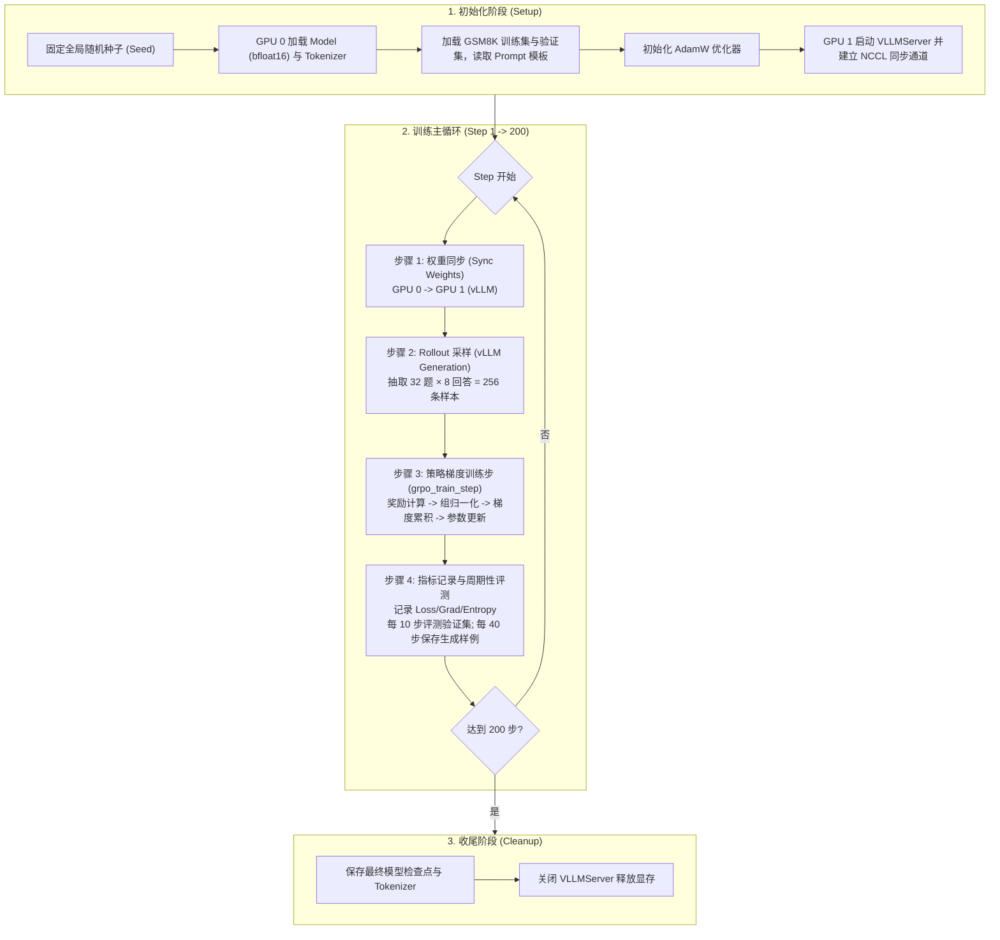

# GRPO 端到端训练流程设计指南 (train_grpo.py)

本指南针对斯坦福 CS336 作业五 **Section 4.3 (Problem grpo_experiments_standard_on_policy)**，系统梳理编写 `train_grpo.py` 所需的整体架构、数据流转、各阶段执行逻辑以及关键不变式检查，供编码实现时对照参考。

---

## 1. 系统架构与硬件拓扑

GRPO 训练采用**训练-推理分离的双卡架构**，以最大化推理吞吐并避免训练反向传播与推理 KV Cache 之间的显存冲突：

* **GPU 0（训练卡，`cuda:0`）**：
  * 托管可训练的 HuggingFace 语言模型策略（`OLMo-2-0425-1B`，`bfloat16` 精度）。
  * 托管优化器（`torch.optim.AdamW`）及梯度缓存。
  * 运行底层训练步 `grpo_train_step`，执行分词、前向微批次计算、梯度累积反传与参数更新。
* **GPU 1（推理卡，`gpu=1`）**：
  * 启动独立的 `VLLMServer` 实例。
  * 借助 vLLM 的 PagedAttention 引擎，负责高并发批量生成 Rollout 回答。
* **跨卡通信（NCCL Weight Sync）**：
  * 在初始化阶段建立双卡间的 NCCL 通信组（`vllm_server.init_weight_sync("cuda:0")`）。
  * 在每个训练 step 采样前，通过该通信组将 GPU 0 的最新模型权重快速广播同步至 GPU 1。

---

## 2. 核心超参数配置清单

根据讲义推荐实验设置，标准 on-policy GRPO 训练的核心超参数如下：

| 配置模块 | 超参数项 | 推荐默认值 | 作用说明 |
| :--- | :--- | :--- | :--- |
| **训练规模** | `num_rollout_steps` | `200` | 总训练迭代轮数 |
| | `rollout_batch_size` | `256` | 每次采样的 Rollout 总量 ($32 \times 8$) |
| | `train_batch_size` | `256` | On-policy 设置下与 `rollout_batch_size` 相同 |
| | `group_size` ($G$) | `8` | 每个 Prompt 生成的候选回答数量 |
| | `n_train_examples` | `6400` | 训练集采样子集规模 |
| | `n_val_examples` | `1024` | 验证集评测题数（减少评估方差） |
| **梯度更新** | `gradient_accumulation_steps` | `32` | 梯度累积微批次数（每个微批次 8 条序列） |
| | `learning_rate` | `1e-5` | AdamW 学习率 |
| | `adam_betas` | `(0.9, 0.95)` | AdamW 动量与二阶方差衰减率 |
| | `weight_decay` | `0.0` | 权重衰减系数 |
| | `max_grad_norm` | `1.0` | 梯度裁剪范数阈值 |
| **vLLM 采样** | `sampling_temperature` | `1.0` | 保证生成多样性与探索度 |
| | `sampling_top_p` | `1.0` | 采样截断阈值 |
| | `sampling_max_tokens` | `512` | 单次生成最大 token 数 |
| | `stop_strings` | `["</answer>"]` | 显式停止词标记 |
| | `include_stop_str_in_output` | `True` | 在输出中保留闭合标签以供解析 |
| **监控频率** | `eval_every_n_steps` | `10` | 每 10 个 step 在验证集上评测一次准确率 |
| | `log_rollouts_every_n_steps` | `40` | 每 40 个 step 打印并记录定性 Rollout 文本 |

---

## 3. 端到端流程图解

---

## 4. 各阶段详细执行规范

### 阶段一：环境与组件初始化
1. **全局种子设定**：
   * 对 Python `random`、`numpy`、`torch` 及其 CUDA 模块均设定相同的 Seed。
2. **模型与 Tokenizer 加载**：
   * 使用 `cs336_alignment.checkpoint.get_model_and_tokenizer` 加载 `allenai/OLMo-2-0425-1B`。
   * 模型放置在 `cuda:0`，数据类型设为 `torch.bfloat16`。
3. **数据准备与迭代器构建**：
   * 解析 `data/gsm8k/train.jsonl` 与 `data/gsm8k/test.jsonl`。
   * 对于每条数据，提取题干与真实答案（真实答案通过 `####` 切分并清理前后空白）。
   * 将题干填入 `cs336_alignment/prompts/r1_zero.prompt` 模板中。
   * 构建一个可循环遍历打乱的训练集 Batch 生成器（每次 yield $B=32$ 道题目）。
4. **启动推理引擎**：
   * 实例化 `VLLMServer(model_id=..., gpu=1)` 并调用其启动方法。
   * 调用 `init_weight_sync("cuda:0")` 完成与主训练卡的跨卡同步初始化。

---

### 阶段二：主迭代循环（200 步）

每个 step 的详细处理逻辑如下：

#### 步骤 1：同步策略权重
* **调用**：`vllm_server.sync_policy_weights(model)`。
* **要点**：必须在每次推理生成前调用，确保 vLLM 采样使用的模型参数完全等于当前 step 最新的策略网络，满足 on-policy 条件。

#### 步骤 2：生成 Rollouts 并整理数据
* **批量提取**：从训练集加载器中取出当前批次的 $B=32$ 道题目。
* **展开构造**：将每道题的 Prompt 复制 $G=8$ 次，得到长度为 $256$ 的 Prompt 列表；对应地，将每道题的标准数值答案也复制 $8$ 次，得到长度为 $256$ 的 Ground Truth 列表。
* **并发采样**：配置 SamplingParams（`temperature=1.0`, `max_tokens=512`, `stop=["</answer>"]`, `include_stop_str_in_output=True`），调用 `vllm_server.generate_completions`。
* **提取输出**：将每个 Completion 的文本内容提取为包含 $256$ 个字符串的响应列表。

#### 步骤 3：执行单步训练与参数更新
* **调用接口**：直接调用已实现的 [`grpo_train_step`](file:///e:/CS336-alignment/assignment5-alignment/cs336_alignment/train.py)。
* **传入参数**：
  * 训练对象：`model`, `tokenizer`, `optimizer`
  * 批次数据：`repeated_prompts`, `rollout_responses`, `repeated_ground_truths`
  * 打分函数：`cs336_alignment.drgrpo_grader.r1_zero_reward_fn`
  * 超参数：`group_size=8`, `gradient_accumulation_steps=32`, `max_grad_norm=1.0`
  * 算法配置：`baseline="mean"`, `advantage_normalizer="std"`, `loss_normalization="sequence"`
* **返回结果**：返回该 step 的标量 `loss` 以及包含 `norm`、`mean_total_reward`、`mean_format_reward` 等监控项的 `metadata` 字典。

#### 步骤 4：指标记录与定期评估
1. **常规监控**：
   * 将当前 step 的 `loss`、`grad_norm`、`mean_total_reward`、`mean_format_reward` 记录到日志或 Wandb。
2. **定期验证（每 10 个 step）**：
   * 从验证集中选取 1,024 个题目，使用当前 vLLM 服务进行贪婪或低方差采样生成。
   * 调用 `r1_zero_reward_fn` 评判，计算整体验证准确率（`val_accuracy`）与平均生成长度。
   * 观察 `val_accuracy` 是否随训练推进从接近 0% 稳步提升至 25% 以上。
3. **定性观察（每 40 个 step）**：
   * 保存当前批次中前 2~3 个题目的完整回答文本（查看 `<think>` 思维链与 `<answer>` 标签）。

---

### 阶段三：收尾与模型持久化
1. 训练完成后，调用 `model.save_pretrained(save_directory)` 和 `tokenizer.save_pretrained(save_directory)` 保存权重。
2. 调用 `vllm_server.stop()` 优雅终止 vLLM 服务进程。

---

## 5. 关键不变式与排错检查清单 (Invariants Checklist)

在编写和测试 `train_grpo.py` 时，请务必核对以下要点：

* [ ] **组对齐一致性**：`repeated_prompts` 与 `repeated_ground_truths` 中同一题目的连续重复次数必须严格等于 `group_size=8`，保证 `compute_group_normalized_rewards` 在 reshape 为 `(32, 8)` 时每行数据属于同一道题目。
* [ ] **标签处理**：GSM8K 原始文件中的真实答案包含解题过程与最终数值（如 `... #### 72`），传给 `grpo_train_step` 的必须是提取并去除空格后的纯答案（如 `"72"`）。
* [ ] **权重同步时机**：确保在 `optimizer.step()` 更新权重**之后**、下一次调用 `generate_completions` **之前**执行 `sync_policy_weights`。
* [ ] **验证集独立性**：验证集评测切勿计算梯度，且使用独立的数据子集（`test.jsonl`）。
* [ ] **显存隔离**：确保训练模型与推理引擎分别严格绑定在 `cuda:0` 和 `cuda:1`，避免单卡显存溢出。

  grpo_train_step(

​          model=model,

​          tokenizer=tokenizer,

​          optimizer=optimizer,

​          gradient_accumulation_steps=config.gradient_accumulation_steps,

​          max_grad_norm=config.max_grad_norm,

​          reward_fn=r1_zero_reward_fn,

​          repeated_prompts=repeated_prompts,

​          rollout_responses=rollout_responses,

​          repeated_ground_truths=repeated_ground_truths,

​          group_size=config.group_size,

​          baseline=config.baseline,

​          advantage_eps=config.advantage_eps,

​          advantage_normalizer=config.advantage_normalizer,

​          importance_reweighting_method=config.importance_reweighting_method,

​          old_log_probs=None,

​          cliprange=config.cliprange,

​          loss_normalization=config.loss_normalization,

​          normalization_constant=config.normalization_constant

​          )
